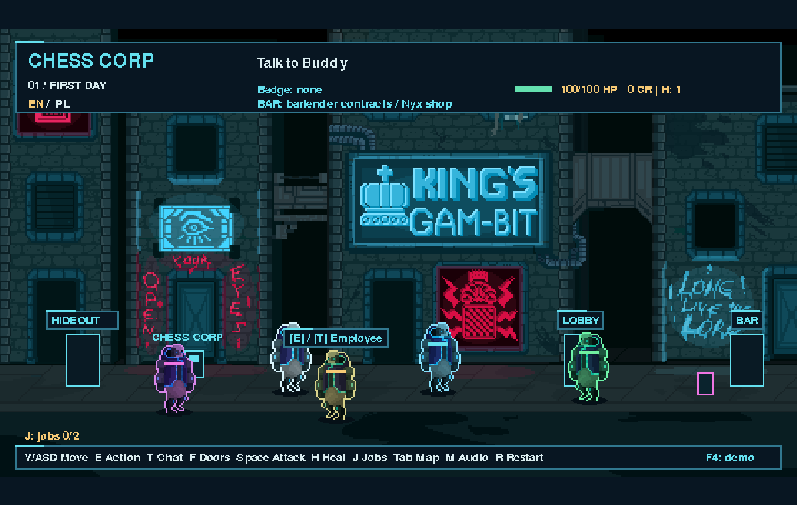

# Chess Corp

**AI-Driven Cyberpunk RPG / Living AI World**

Built for the **Meta AI Hackathon 2026**.

Explore a neon corporate district where NPCs have their own goals, memories and conversations. Meta Muse Spark generates dialogue, playable quest plans and coordinated NPC decisions. The game validates those plans and executes them through deterministic rules.



## Demo

**YouTube walkthrough:** link to be added.

To reproduce the demo locally, follow [Quick start](#quick-start), open the game and keep the [AI Inspector](#ai-inspector-and-jury-view) beside it. The public repository starts in MOCK mode; live Meta inference is an explicit opt-in.

## Gameplay

- **Four connected locations:** Chess Corp Street, Cybroschligger Bar, Hacker Hideout and Corporate Lobby. Door transitions preserve quests, inventory, conversations and NPC state within the current run.
- **NPC identities:** Buddy, Security, Hacker, Employee and location-specific characters, including the bartender, Nyx and corporate staff. NPCs move, patrol, inspect terminals, talk and react to the player. They stop nearby for conversation.
- **Dynamic quests:** collect objects, activate three terminals in an AI-selected sequence, or solve a constrained logic puzzle. Two additional collection jobs are generated at the start of a fresh backend session.
- **Deterministic puzzles:** the model personalizes approved arithmetic templates; the engine constructs the question and checks the unique answer. Incorrect terminal order resets sequence progress.
- **Combat and economy:** fight cyber-rats, complete bartender contracts, collect credits and buy medkits, a weapon upgrade or armour from Nyx. Attacking an NPC can provoke a defensive response.
- **Inventory and progression:** carry quest items, earn rewards and retain purchases while travelling between locations. Restarting a run resets gameplay progress; this is not a persistent-save RPG.
- **EN / PL:** English is the default. The language preference survives location changes and page refreshes. Previously generated text in another language remains explicitly marked as original content.
- **Local audio:** conversation, combat, doors, purchases and rewards have synthesized effects. Interior locations have ambient sound; the street rain/city-noise loop is currently muted.

The introductory badge quest and rat bounty contracts are authored scenarios. The AI-generated collection jobs and Director quests are separate systems; rat contracts are not presented as newly generated model output.

## Three systems powered by Meta Muse Spark

### Buddy AI

Buddy is the player's corporate guide. Text chat also supports nearby NPCs with their own identity, role, goals and conversation history. Requests include bounded game context and use the player's selected language.

The local NPC Guard classifies requests as `ALLOWED`, `OUT_OF_SCOPE` or `BLOCKED`, helping keep conversations inside Chess Corp and resist instruction-extraction and prompt-injection attempts. It does not add a separate paid LLM call to every message and is not a guarantee against every possible attack.

### AI Game Director

After the introductory quest, the Director can choose `COLLECT`, `SEQUENCE` or `LOGIC_PUZZLE`. A separate session-job request creates two collection errands for a fresh backend session, including descriptive text, approved placements and credit rewards.

The model returns a structured JSON plan, never executable code. Pydantic validation and client-side checks constrain allowed actions, object IDs, locations and completion conditions. The engine checks interactions, solves puzzle rules and awards each collection-job reward once.

Press **J** to view session jobs; it opens the journal rather than generating another plan. A new ordinary run creates a new session. For a new jury demonstration, create a new demo session in the owner panel: restarting inside the same demo-session link can reuse that session's accepted jobs.

### Living World AI

One batched request plans behaviour for several NPCs using their current location, goals, moods, short-term memories and recent world events. Approved actions are `MOVE_TO`, `PATROL`, `WAIT`, `TALK_TO`, `INSPECT_TERMINAL` and `REACT_TO_PLAYER`.

Pygame performs movement and action transitions locally. Model updates are rate-limited, not requested every frame. If the API is slow, unavailable or over budget, local behaviour keeps the world active. `MOCK`, `META` and `FALLBACK` remain distinct sources in the Inspector.

## Meta Muse Image assets

The backend integrates Meta Muse Image (`muse-image-1.0`) for a small approved asset registry: a hacker-hideout emblem, a cyber-rat and Nyx. Generated assets are included with public provenance manifests.

Image processing converts results to game-ready PNGs, applies nearest-neighbour scaling and, for sprites, removes the explicitly requested chroma-key background. Four lightweight animation frames are derived locally from a generated sprite; they are not four independent model generations.

Assets are cached on disk and reused. **Starting or refreshing the game does not generate new images.** The authenticated owner panel provides explicit regeneration and cache-clearing controls; the game periodically picks up updated assets. Clearing generated files does not remove original artwork or reset spending records. Missing assets fall back to existing game graphics.

The Inspector distinguishes a cached asset from a new Meta generation and can show its source, model, latency and preview.

## Architecture

| Layer | Implementation |
|---|---|
| Game client | Pygame CE, packaged with pygbag for Python/WebAssembly in the browser |
| Web delivery | Nginx serves the game and forwards API requests to FastAPI |
| Backend | FastAPI adapters for NPC chat, quests, World AI, assets and Inspector access |
| AI | Meta Muse Spark for text and structured decisions; Meta Muse Image for assets |
| Contracts | Closed JSON schemas, Pydantic validation and matching client-side checks |
| Execution | Deterministic local movement, combat, collection and puzzle rules |
| State | In-memory sessions and call history; cached assets and configured spending records on disk |

AI selects narrative content and permitted plans; it does not execute code or directly mutate game state. The browser talks to the backend, and the Meta API key stays on the server. The demo runs with Docker Compose and does not require additional cloud or observability services.

## AI Inspector and jury view

Open **[the owner Inspector](http://localhost:8080/admin)** and sign in using the `ADMIN_TOKEN` configured in your local `.env`.

The Inspector retains the latest **200 calls in RAM**, updates automatically and shows:

- Provider and model, latency, token usage when available, and errors.
- The actual outgoing payload and model response in the authenticated owner view, with secret masking.
- Generated JSON plans, validation results and reported execution progress.
- The active location, NPC goals, states, memories and recent events.
- Asset provenance, generation/cache status and previews.

For a presentation:

1. Create a demo session in the owner panel.
2. Open the generated **game-session link**.
3. In a separate browser profile or incognito window, open **[the jury view](http://localhost:8080/admin/jury)** and enter the issued jury token.
4. Show a `Director / SESSION_JOBS` call beside the matching quests under **J**, then complete a quest and show its execution result.

The jury capability expires after 30 minutes and is limited to its assigned session. Full prompts, conversation histories and session identifiers are hidden from that view. The jury interface defaults to English; the owner panel defaults to Polish and has a language selector. Restarting the backend clears the in-memory Inspector history and access sessions.

## Quick start

**Requirements:** Git and Docker with Compose. On Windows, use Docker Desktop with Linux containers; WSL can use Docker Desktop integration. No host Python installation is required for this path. The first build and initial browser runtime loading require internet access.

```bash
git clone https://github.com/pio3m/meta_ai_hakaton_2026.git
cd meta_ai_hakaton_2026
```

On a fresh clone, create your local configuration using either shell:

```powershell
# Windows PowerShell
Copy-Item .env.example .env
```

```bash
# Linux, macOS or WSL
cp .env.example .env
```

Set `ADMIN_TOKEN` to a long, randomly generated value of at least 32 characters in `.env` if you want to use the Inspector. Do not overwrite an existing configuration when updating the project.

```bash
docker compose up --build -d
```

Open **[http://localhost:8080/](http://localhost:8080/)**, wait for loading and click **Play**. Click the game to give it keyboard focus. After rebuilding, refresh the page with **Ctrl+F5**.

```bash
docker compose ps
docker compose logs --tail=50 backend game
docker compose down
```

The Compose port is bound to the local computer. To use another port, set `CHESS_CORP_PORT` in your local `.env` and recreate the containers. The included Compose setup is a local demo, not a public hosted game service.

## MOCK defaults and live Meta access

The public defaults in [`.env.example`](.env.example) use **MOCK** and disable paid requests. You can explore the world, use mock chat, generate mock quests and inspect simulated calls without a Meta API key. A mock result is not a live model decision; a cached Meta image is not a new image-generation call.

Live inference requires your own authorized Meta API credentials in `MODEL_API_KEY`, access to the configured models, and explicit paid-request flags:

| System | Mode | Required paid-request switches |
|---|---|---|
| Buddy / NPC chat | `BUDDY_MODE=meta` | `META_ALLOW_PAID_REQUESTS=true` |
| Quest Director and fresh session jobs | `DIRECTOR_MODE=meta` | `META_ALLOW_PAID_REQUESTS=true` and `DIRECTOR_ALLOW_PAID_REQUESTS=true` |
| Living World AI | `WORLD_AI_MODE=meta` | `WORLD_AI_ALLOW_PAID_REQUESTS=true` |
| Manual asset generation | `ASSET_AI_MODE=meta` | `ASSET_AI_ALLOW_PAID_REQUESTS=true` |

The text adapter defaults to `META_MODEL=muse-spark-1.3`. Configure limits before enabling live calls: World AI has per-session/global call caps, a minimum interval and a token budget; session jobs and image generation have separate caps. Persistent World AI spending tracking requires a configured `WORLD_AI_LEDGER_PATH`; an empty value uses the legacy in-memory budget. Do not delete spending records to renew an allowance.

After changing local settings, apply them with:

```bash
docker compose up -d --force-recreate backend game
```

Paid modes can incur charges as you play or start fresh sessions. Image generation remains an explicit owner action. The repository does not distribute credentials, private request metadata or the local recording-session spending counters.

## Controls

| Key | Action |
|---|---|
| **WASD** | Move along the scene's walkable area |
| **E** | Interact, advance authored dialogue, collect an object or use a terminal |
| **T** | Open text chat with a nearby NPC |
| **Enter** | Advance dialogue, send a message, submit a puzzle answer or confirm a purchase |
| **F** | Enter or leave a location through a nearby doorway |
| **J** | Open the two session collection jobs |
| **Space** | Melee attack; hold to keep attacking |
| **H** | Use a medkit |
| **Up / Down** | Select an item while the Nyx shop is open |
| **Tab** | Open the location map |
| **Esc** | Close the current dialogue, journal or panel |
| **M** | Toggle audio outside text-entry handling |
| **F2** | Switch EN / PL |
| **R** | Start a new run when no blocking panel is open |
| **F4** | Select a mock Director scenario before completing the introductory quest |

## Development and validation

For Python development, install Python 3.12+ and `uv`, then run:

```bash
uv sync --locked
uv run python -m pytest -q
```

The test suite covers game rules, schema validation, guard behaviour, mock integrations, localization, audio and session isolation. Browser walkthroughs and historical validation records are preserved in the [change reports](docs/changes/README.md). Live-test scripts are records of controlled paid experiments, not part of the default test command.

## Assets and licensing

- **Original artwork:** supplied by the project owner in [`grafika/`](grafika/). Original files are preserved; processed derivatives are in [`assets/processed/`](assets/processed/). Public availability does not grant a blanket open-source license to the artwork. See the [asset inventory](docs/ASSET_REPORT.md) for provenance and processing details.
- **Meta-generated artwork:** cached under [`assets/generated/`](assets/generated/) with public model/source manifests. Private generation metadata is excluded. The audio dedication does not apply to these images.
- **Synthesized audio:** original local WAV effects and ambient tracks contain no third-party samples. The audio and its generator are dedicated under [CC0 1.0](assets/audio/LICENSE.md); see the [audio notes](assets/audio/README.md) and [manifest](assets/audio/manifest.json).
- **Dependencies and bundled fonts:** retain their respective upstream licensing terms; no project-wide license grant is implied for third-party material.

## Development archive

The previous README and its milestone-by-milestone Polish development history are preserved in the [Polish development archive](docs/DEVELOPMENT_HISTORY_PL.md).
